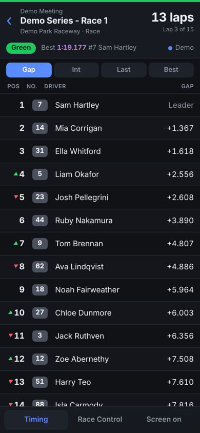
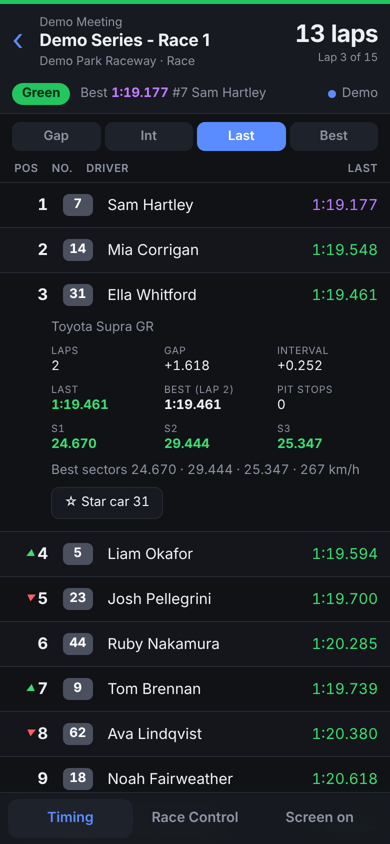
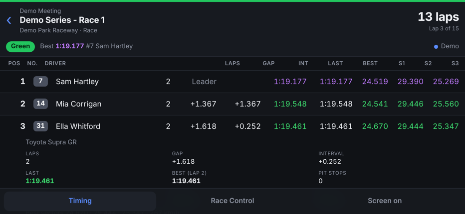

# Natsoft Web Wrapper

A fast, phone-friendly live timing page for Australian motorsport meetings timed by
[Natsoft](http://racing.natsoft.com.au/), plus a clean JSON feed for broadcast graphics.

It runs on [Cloudflare Workers](https://workers.cloudflare.com/), deploys in a few minutes, and usually stays
inside Cloudflare's free plan.

<p align="center">
  
  &nbsp;&nbsp;
  
</p>

> **Unofficial.** This project isn't affiliated with or endorsed by Natsoft, Supercars or any category. It reads
> the same public live timing feed as Natsoft's own web page. See [Using it responsibly](#using-it-responsibly).

## Features

- **Timing tower built for phones**: position (with ▲▼ when it changes), car number, driver, and a switchable
  Gap / Interval / Last lap / Best lap column. Turn the phone sideways for every column, including sectors.
- **Timing colours**: purple for the session-best lap and sectors, green for a driver's personal best.
- **Tap a car** for its vehicle, laps, gaps, last and best laps, sectors, speed trap and pit stops.
- **Flag status at a glance**: the top of the screen turns green, yellow, red or chequered.
- **Race Control tab** with stewards' and race control messages, and a badge for new ones.
- **Star cars** to highlight the ones you're following.
- **Screen on** mode keeps your phone awake trackside.
- **Installs to your home screen** and opens full screen like an app.
- **JSON and WebSocket API** for vMix, OBS and other graphics systems.
- **Demo race** (meeting `DEMO`) for trying it when nothing is on track.
- **Optional access key** to keep your deployment private.

<p align="center">
  
</p>

## How it works

```
Natsoft live timing ──► one connection per meeting ──► Cloudflare relay ──► phones · tablets · overlays
```

A Cloudflare Durable Object holds a **single** connection to Natsoft for each meeting, however many people are
watching. It connects only while someone has the page open or something is polling the API, and disconnects
two minutes after the last viewer leaves. Viewers get a full snapshot when they join, then small updates with
only what changed (about 4–5 MB an hour on a phone).

## Deploy your own

You need a free [Cloudflare account](https://dash.cloudflare.com/sign-up).

### Option 1: from the Cloudflare dashboard (no terminal)

1. Fork this repository, or upload its files to a repository of your own.
2. In Cloudflare, go to **Workers & Pages → Create application → Import a repository** and choose it.
3. Keep the Worker name **`natsoft-live`** (it must match `name` in `wrangler.jsonc`), then **Save and Deploy**.

Every push to the repository redeploys it automatically.

### Option 2: with Wrangler

Requires [Node.js](https://nodejs.org) 18 or later.

```sh
git clone <this repository>
cd Natsoft-Web-Wrapper
npm install
npx wrangler login
npm run deploy
```

Either way, you'll get an address like `https://natsoft-live.<your-subdomain>.workers.dev`.

### Check it can reach Natsoft

Open your address and tap **Test the connection** (or go to `/#check:V8SUPER`). It runs four steps:

| Step | What it checks |
|---|---|
| Load the meeting page | Cloudflare can reach Natsoft's server on port 8080 |
| Find the live token | Natsoft issued a token for the session |
| Open the live timing WebSocket | Natsoft accepted the live connection |
| Wait for the first message | `<New>` means timing is flowing; `NotFound` also passes (Natsoft answered, but the meeting isn't live right now) |

If the first or third step fails, Natsoft is refusing connections from Cloudflare's network. The relay code is
plain TypeScript, so you can run it anywhere else that allows outbound TCP to port 8080.

### Keep it private (recommended)

By default anyone with the address can use your deployment. To require a key:

- **Dashboard:** Worker → **Settings → Variables and Secrets** → add a secret named `ACCESS_KEY`.
- **Wrangler:** `npx wrangler secret put ACCESS_KEY`

The page asks for the key once and remembers it on that device. The page itself still loads for anyone; the
timing data doesn't. For individual logins, put
[Cloudflare Access](https://developers.cloudflare.com/cloudflare-one/applications/configure-apps/self-hosted-apps/)
in front instead (free for up to 50 users).

## Using the page

- Enter a **meeting ID**: the part after `/LiveMeeting/` in a Natsoft live timing link. You can also paste the
  whole link.
  - `V8SUPER` is used for Supercars weekends, including support categories on the same feed.
  - Other meetings use IDs like `20261011.MOUN` (date and track code).
- If a meeting isn't running yet, the page says so and updates by itself when a session starts.
- **On iPhone:** open the address in Safari, then **Share → Add to Home Screen**.

## API

Add `&key=…` to any request if you set an access key.

### `GET /api/state?meeting=<ID>`

The current state as JSON. Polling keeps the Natsoft connection open until two minutes after the last poll.

```jsonc
{
  "meeting": "DEMO",
  "status": "demo",                  // live · connecting · notLive · retrying · idle · demo
  "meetingName": "Demo Meeting",
  "sessionName": "Demo Series - Race 1",
  "trackName": "Demo Park Raceway",
  "isRace": true,
  "flag": "Green",                   // WaitStart · Green · Yellow · Red · Checkered · Ended
  "clock": { "type": "L", "remaining": 13, "elapsed": 2, "scheduledLaps": 15 },  // L = laps, T = seconds
  "best": { "lap": 79.177, "carId": "1", "number": "7", "driver": "Sam Hartley", "s1": 24.519, "s2": 29.39, "s3": 25.269 },
  "record": { "time": 78.901, "driver": "Sam Hartley", "vehicle": "Ford Mustang GT" },
  "cars": [
    {
      "id": "3", "pos": 3, "no": "31", "driver": "Ella Whitford", "vehicle": "Toyota Supra GR",
      "laps": 2, "last": 79.461, "best": 79.461, "bestLapNo": 2, "gap": 1.618, "int": 0.252,
      "s1": 24.67, "s2": 29.444, "s3": 25.347, "speed": 267, "pit": false, "stops": 0
    }
  ],
  "raceControl": [{ "trackTime": 1792846800, "receivedAt": 1792807200000, "text": "Race Control: Turn 6 incident involving cars 23 & 31 noted" }]
}
```

This example comes from the `DEMO` meeting. Times are in seconds. `gapLaps` and `intLaps` are set when a car is laps down. `trackTime` is the track's local
wall clock encoded as a UTC timestamp, as Natsoft sends it.

**vMix:** add it as **Data Sources → JSON** and poll every second.

### `wss://<host>/api/live?meeting=<ID>`

A WebSocket that pushes updates instead of polling:

- `{"type":"full","data":{…}}`: the whole state (same shape as `/api/state`), sent on connect.
- `{"type":"patch","data":{…}}`: only what changed, at most twice a second. It can contain `header` (all
  top-level fields), `cars` (changed cars, whole objects), `order` (car IDs in position order) and `raceControl`.

`public/app.js` shows how to apply patches. Send `ping` to get `{"type":"pong"}`.

### `GET /api/check?meeting=<ID>`

Runs the connection check above and returns each step as JSON.

## Using it responsibly

- The relay behaves like a single browser tab per meeting, and **never sends anything to Natsoft**. Please keep
  it that way: don't run many relays against the same meeting, and don't lower the reconnect delays.
- The public feed can change or disappear at any time without notice.
- **For commercial or broadcast use, ask the meeting's timekeepers for their official feed** rather than relying
  on the public one.
- Timing data belongs to Natsoft and the event organisers.

## Development

```sh
npm install
npm run dev      # local server at http://localhost:8787 — the DEMO meeting works offline
npm test         # decoder, XML reader, timing model, and the WebSocket client against a fake Natsoft server
npm run check    # TypeScript type-check
```

```
src/index.ts      routes: the page, /api/live, /api/state, /api/check
src/relay.ts      Durable Object: one Natsoft connection per meeting, fan-out to viewers
src/natsoft.ts    live token, connection loop, reconnects, connection check
src/wsclient.ts   HTTP and WebSocket client over a raw TLS socket
src/decoder.ts    Natsoft frame decoding
src/xml.ts        a tiny XML reader (Workers have no DOMParser)
src/timing.ts     timing state and the JSON snapshot
src/demo.ts       the made-up DEMO race
public/           the phone page (plain HTML, CSS and JavaScript; no build step)
test/             tests
```

### Notes on the Natsoft feed

1. The relay loads `https://server.natsoft.com.au:8080/LiveMeeting/<ID>` and reads its `gsLiveToken`.
2. It opens `wss://server.natsoft.com.au:8080/LiveMeeting/<ID>?Token=…` with the same User-Agent and Natsoft's
   Origin. The token only works with the User-Agent that fetched it.
3. Frames are XML, either plain or XOR-chained with a few macro codes (`src/decoder.ts`). The server sends a
   full `<New>` snapshot, then updates: `L` leaderboard, `C` clock, `S` flag, `A` session best, `G` race control.
4. `<NotFound/>` means the meeting isn't live (retry in 30 s), `<Redirect/>` is followed straight away, and
   errors retry after 10 s.

Cloudflare's `fetch()` only reaches ports 80 and 443, so the relay opens a TLS socket to port 8080 with
`connect()` and speaks HTTP and WebSocket itself (`src/wsclient.ts`).

## Acknowledgements

The protocol notes build on the reverse-engineering in
[J-Haynes/supercars-timing](https://github.com/J-Haynes/supercars-timing).
